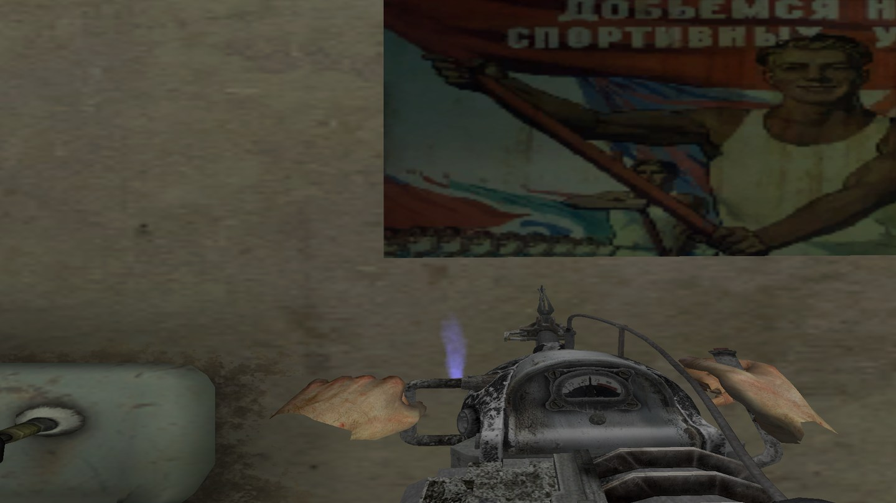

> [!IMPORTANT]
> **💬 TEST BUILDS & DISCUSSION**
>
> **[Join the Flat2VR Discord](https://discord.gg/P4q9zt7ek)** · **[Open the You Are Empty: Absolute Edition thread](https://discord.com/channels/747967102895390741/1569714598318313594)**
>
> Download the latest test build from the thread and share your results there.

  

## 📦 INSTALLATION

1. Install the supported **Absolute Edition** PC build and get the **YAEVR R50** test package.
2. Extract the complete mod into its own folder. If detection fails, put the game path in `GAME_PATH.txt`.
3. Connect PC VR, select your OpenXR runtime and run **`RUN.bat`**. On a fresh profile, the launcher starts the first level.

## ⚡ FEATURES

### MELEE WITH EITHER HAND

Aim with the right-hand weapon while keeping an independent left hand. The test loadout covers 12 original weapons.

### HANDS MEET THE WALL

Both hands stop at tested walls and release cleanly when you pull away.

### START FRESH OR RESUME A SAVE

The launcher starts a new campaign on a clean profile or resumes an existing checkpoint. R50 adds an English launcher and game interface, plus ultrawide startup support.

The fresh-profile and wall tests used the original game in XR Sim.

## 📸 In-game screenshots

  
  

[Tester credits](TESTERS.md) · [Build details](docs/PROJECT_STATUS.md)

## 🎮 Other VR mods

- [Alone in the Dark (2008) VR](https://github.com/Monsterdeadwood/AloneInTheDark2008VR)
- [Battlefield 3: VRevamp](https://github.com/Monsterdeadwood/Battlefield-3-VRevamp)
- [Burnout Paradise Remastered VR](https://github.com/Monsterdeadwood/BUrnOutPvr)
- [Crysis 2: VRevamp](https://github.com/Monsterdeadwood/C2VR)
- [NOVA · CS:GO Legacy VR](https://github.com/Monsterdeadwood/CSGOVR)
- [Metro 2033 VR](https://github.com/Monsterdeadwood/Metro2033VR)
- [Rainbow Six Siege VR](https://github.com/Monsterdeadwood/SiegeVR)
- [Star Wars: The Force Unleashed II VR](https://github.com/Monsterdeadwood/TFU2VR)
- [TimeShift VR](https://github.com/Monsterdeadwood/TimeShiftVR)
- [Titanfall 1 VR](https://github.com/Monsterdeadwood/Titanfall1VR)
