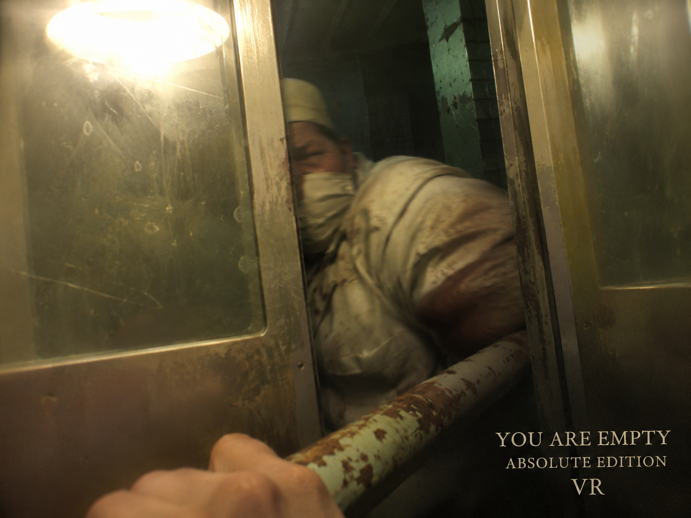

> [!IMPORTANT]
> **DOWNLOAD & DISCUSSION**
>
> **[Join the Flat2VR Discord](https://discord.gg/P4q9zt7ek)** · **[Open the You Are Empty: Absolute Edition thread](https://discord.com/channels/747967102895390741/1569714598318313594)**
>
> Get the mod and share feedback in the game’s Flat2VR thread.

  

## Features

**Head tracking · Tracked right-hand aiming · Independent left hand · Melee with either hand**

###  Shoot with one hand and strike with either

Aim your gun with your right hand and use your free left hand for melee. You can strike with either hand at close range.

###  Brace a hand against the wall

Reach out and touch a wall with either hand. It stops at the surface and moves freely again when you pull back.

###  Switch weapons and open your inventory in VR

Use the right stick to move through your weapons and open the inventory from the controller, then return directly to the fight.

## Installation

1. Install the **Absolute Edition** of **You Are Empty** on PC.
2. **Put the mod archive next to the game’s `.exe`.** Extract the complete archive there and keep the mod folder intact.
3. Connect PC VR, select your OpenXR runtime, and run **`RUN.bat`** from the extracted mod folder. If the launcher needs the game path, enter it in `GAME_PATH.txt`.

## In-game screenshots

  
  

[Tester credits](TESTERS.md)

## Other VR mods

| VR mod | Highlights |
| --- | --- |
| [Alone in the Dark (2008) VR](https://github.com/Monsterdeadwood/AloneInTheDark2008VR) | Sweep a flashlight across the room, then grab a chair and carry it by hand. |
| [Battlefield 3: VRevamp](https://github.com/Monsterdeadwood/Battlefield-3-VRevamp) | Pull a dropped enemy rifle toward you, take it with your other hand and fire. |
| [Burnout Paradise Remastered VR](https://github.com/Monsterdeadwood/BUrnOutPvr) | Look into a corner, drift through it and hit boost as you straighten out. |
| [Crysis 2: VRevamp](https://github.com/Monsterdeadwood/C2VR) | Lift an enemy with your free hand and fling them across the room with a swing. |
| [NOVA · CS:GO Legacy VR](https://github.com/Monsterdeadwood/CSGOVR) | Bring the AWP’s scope up to your eye and feel the kick when you shoot. |
| [Metro 2033 VR](https://github.com/Monsterdeadwood/Metro2033VR) | Ricochet a glowing power core down a tunnel and watch it light the walls as it travels. |
| [Rainbow Six Siege VR](https://github.com/Monsterdeadwood/SiegeVR) | Reach for the rifle’s foregrip and steer the muzzle with both hands. |
| [Star Wars: The Force Unleashed II VR](https://github.com/Monsterdeadwood/TFU2VR) | Hold a Stormtrooper in the air with the Force and swing a lightsaber with your other hand. |
| [TimeShift VR](https://github.com/Monsterdeadwood/TimeShiftVR) | Let go of the foregrip for a quick punch, or strike with the rifle itself. |
| [Titanfall 1 VR](https://github.com/Monsterdeadwood/Titanfall1VR) | Call down a Titan, climb in and send captured shots back with the Vortex Shield. |
