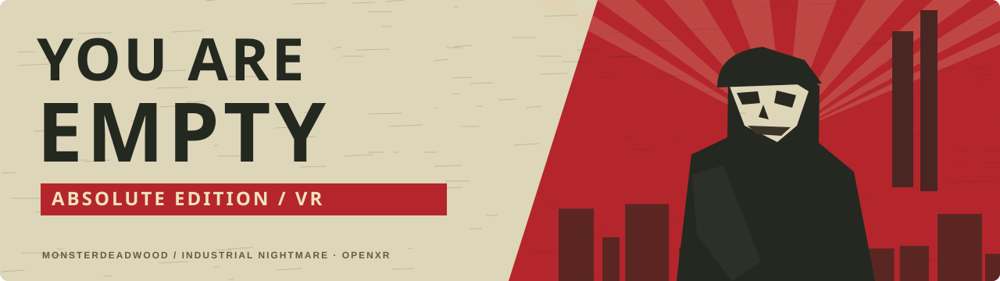

> [!IMPORTANT]
> **[ТЕСТИРОВАНИЕ И ОБСУЖДЕНИЕ · FLAT2VR DISCORD](https://discord.gg/P4q9zt7ek)**
> Тестирование, запрос сборок, отзывы и обсуждение проходят в **Flat2VR Modding Discord**. Перейди на сервер и найди тему **You Are Empty: Absolute Edition VR**.

# You Are Empty: Absolute Edition VR

[English](README.md) · [Русский](README_RU.md) · [Flat2VR Discord](https://discord.gg/P4q9zt7ek) · [All projects](PORTFOLIO.md)

VR-мод You Are Empty: Absolute Edition: оружие от контроллера, независимая левая ладонь, ближний бой обеими руками и взаимодействие с родной игрой. R46 сохраняет игровую ветку R45 и исправляет присланную проблему совместимости запуска.

**Текущая описанная ветка: R46 startup compatibility preview.**

## Установка

1. Возьми текущую сборку **YAEVR R46** в теме You Are Empty на Flat2VR. Поддерживаемая Absolute Edition должна быть установлена отдельно.
2. Распакуй целую единую папку мода.
3. Подключи PC VR через свой активный OpenXR runtime и открой **RUN.bat**.
4. Если автоопределение не сработало, запиши полный путь к игре в **GAME_PATH.txt**. По умолчанию загружается Save0; другой слот задаётся RUN.bat --slot SLOT_NAME.
5. Оставь консоль открытой. После теста отправь созданный локальный диагностический ZIP в тему Discord.

Доступность актуальных тестовых пакетов уточняется в Discord. Нужен полный пакет для поддерживаемой версии игры; страница проекта сама по себе не является скачиваемым релизом.

## Что есть в проекте

- Оружие от правой руки, независимая левая ладонь и ближний бой каждой рукой.
- Тестовый набор из 12 видов оружия и взаимодействие по направлению контроллера.
- Ограничение и отпускание обеих рук у проверенных статических стен через вычисленные по исходникам оболочки коллизии.
- Управление инвентарём, сбросом камеры и паузой из VR.
- SMAA High, FSR 1 и использование текущего OpenXR runtime.
- Исправление запуска R46 сохраняет точную проверку поддерживаемых игровых модулей и моделей.

<b>Краткое управление</b>

| Действие / кнопка | Назначение |
| --- | --- |
| Right trigger / left trigger | Огонь / поддерживаемое вторичное действие |
| A or right grip | Взаимодействие |
| B / X / Y | Перезарядка / прыжок / переключить приседание |
| Left stick / click | Движение / бег до отпускания стика |
| Right stick horizontal / vertical / click | Поворот / предыдущее-следующее оружие / инвентарь |
| Left grip hold | Инвентарь; отпустить для закрытия |
| Left Menu tap / hold | Сброс камеры / пауза-продолжение |

Полная инструкция управления в конкретной сборке учитывает её версию и профиль контроллеров.

## Текущий статус

**Экспериментальная сборка.** Коллизии R45, 12 видов оружия и Save0 проверялись в настоящей игре через XR Sim. R46 проверила запуск/игру с присланными идентификаторами игры и Steam DLL.

- Принятие в физических Meta/SteamVR-шлемах и вся кампания ещё требуют проверки.
- Проблема первого лица met6, перенос/бросок Thunder, урон/боезапас огнемёта и все переходы сцен/новых VM ещё не проверены полностью.

[Подробный статус и область проверки](docs/PROJECT_STATUS.md)

## Тестирование и отзывы

Напиши в [тему игры на Flat2VR](https://discord.gg/P4q9zt7ek): укажи **версию мода, игру/магазин, шлем, OpenXR runtime, GPU, шаги воспроизведения и диагностический ZIP сборки**. Для проблем изображения или управления полезно короткое видео.

## Другие мои VR-моды

| Игра / проект | Направление | Доступ |
| --- | --- | --- |
| [Assassin’s Creed VR](https://github.com/Monsterdeadwood/AC1VR) | Обзор от первого лица, лазание и меч | Закрытый |
| [Crysis 2 VR](https://github.com/Monsterdeadwood/C2VR) | Нанокостюм, физическое взаимодействие и интерфейс | Закрытый |
| [NOVA · CS:GO Legacy VR](https://github.com/Monsterdeadwood/CSGOVR) | Локальные матчи CS:GO Legacy с VR-управлением | Закрытый |
| [TimeShift VR](https://github.com/Monsterdeadwood/TimeShiftVR) | Управление временем, девять видов оружия и позы | Закрытый |
| [Alone in the Dark 2008 VR](https://github.com/Monsterdeadwood/AloneInTheDark2008VR) | VR-хоррор и взаимодействие с предметами | Открытый |
| [Rainbow Six Siege VR](https://github.com/Monsterdeadwood/SiegeVR) | Стерео и оружие от контроллеров в старой Siege | Открытый |
| [Burnout Paradise Remastered VR](https://github.com/Monsterdeadwood/BUrnOutPvr) | Стереовождение, меню автомобилей и эффекты | Закрытый |
| [Titanfall 1 VR](https://github.com/Monsterdeadwood/Titanfall1VR) | Бой пилота и кабины титанов | Закрытый |
| [Metro 2033 VR](https://github.com/Monsterdeadwood/Metro2033VR) | Оригинальная Metro в VR и нативная физика | Открытый |
| [Insurgency VR](https://github.com/Monsterdeadwood/InsurgencyVR) | Начальная подготовка VR-интеграции | Закрытый |
| [Counter-Strike: Source VR](https://github.com/Monsterdeadwood/CSSVR) | Разработка VR для Counter-Strike: Source | Закрытый |

Ссылки на закрытые репозитории доступны приглашённым участникам. Открытые страницы отмечены в таблице.

## Авторство и заметки разработки

Проект ведёт [Monsterdeadwood](https://github.com/Monsterdeadwood). Это независимый фанатский VR-проект; нужна собственная поддерживаемая копия оригинальной игры.

Описание сверено: **14 ноября 2026 года**.
