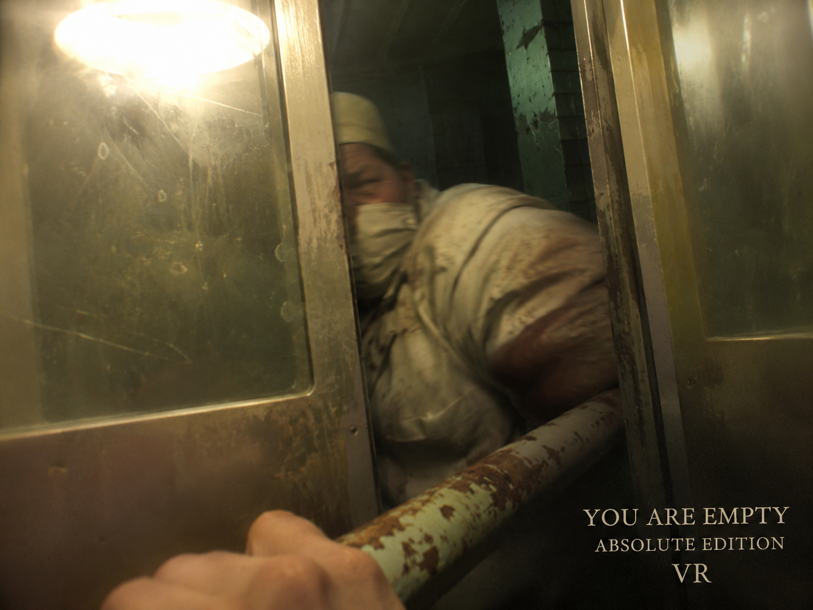

> [!IMPORTANT]
> **[ТЕСТИРОВАНИЕ И ОБСУЖДЕНИЕ · FLAT2VR DISCORD](https://discord.gg/P4q9zt7ek)**
> Тестирование, запрос сборок, отзывы и обсуждение проходят в **Flat2VR Modding Discord**. Перейди на сервер и найди тему **You Are Empty: Absolute Edition VR**.

  

# You Are Empty: Absolute Edition VR

[English](README.md) · [Русский](README_RU.md) · [Flat2VR Discord](https://discord.gg/P4q9zt7ek) · [All projects](PORTFOLIO.md)

VR-мод You Are Empty: Absolute Edition с оружием от контроллера, независимой левой ладонью, ближним боем обеими руками и взаимодействием с предметами игры. R47 может начать новую игру, даже если профиль и сохранения ещё не созданы.

**Базовая сборка на этой странице: R47 first-run test package.**

## Установка

1. Запроси тестовый пакет **YAEVR R47** в теме You Are Empty на Flat2VR. Поддерживаемая Absolute Edition должна быть установлена отдельно.
2. Распакуй папку мода целиком.
3. Подключи PC VR через активную среду OpenXR и запусти **RUN.bat**.
4. Если автоопределение не сработало, запиши полный путь к папке игры в **GAME_PATH.txt**.
5. Лаунчер загружает Save0, а если его нет, выбирает самое свежее обычное сохранение. Если сохранений нет, он запускает первый уровень кампании. Для выбора слота укажи **RUN.bat --slot SLOT_NAME**, для новой игры — **RUN.bat --new-game**.
6. Оставь консоль открытой. Если возникла проблема, приложи созданный диагностический ZIP в теме Discord.

Доступность актуальных тестовых пакетов уточняется в Discord. Нужен полный пакет для поддерживаемой версии игры; страница проекта сама по себе не является скачиваемым релизом.

## Что есть в проекте

- Оружие от правой руки, независимая левая ладонь и ближний бой каждой рукой.
- Тестовый набор из 12 видов оружия и взаимодействие по направлению контроллера.
- Ограничение и отпускание обеих рук у проверенных статических стен через вычисленные по исходникам оболочки коллизии.
- Управление инвентарём, сбросом камеры и паузой из VR.
- SMAA High, FSR 1 и использование текущего OpenXR runtime.
- При первом запуске R47 создаёт недостающие настройки по шаблонам установленной игры и сохраняет существующие.

<b>Краткое управление</b>

| Действие / кнопка | Назначение |
| --- | --- |
| Right trigger / left trigger | Огонь / поддерживаемое вторичное действие |
| A or right grip | Взаимодействие |
| B / X / Y | Перезарядка / прыжок / переключить приседание |
| Left stick / click | Движение / бег до отпускания стика |
| Right stick horizontal / vertical / click | Поворот / предыдущее-следующее оружие / инвентарь |
| Left grip hold | Инвентарь; отпустить для закрытия |
| Left Menu tap / hold | Сброс камеры / пауза-продолжение |

Полная инструкция управления в конкретной сборке учитывает её версию и профиль контроллеров.

## Особенности новых тестовых сборок

- **Запуск на широком экране и английский интерфейс.** В R49–R50 сборка опирается на измеренную область кадра игры, а в R50 интерфейс лаунчера переведён на английский. На чистом профиле и входном 2560×1080 в R50 получили стереопары. Стабильность запуска на других конфигурациях и работу в шлеме ещё предстоит проверить.

## Текущий статус

**Экспериментальная сборка.** В R47 на игре с XR Sim проверены чистый профиль без сохранений и загрузка последнего сохранения при отсутствии Save0. Запуск RUN.bat после распаковки проверен с обоими поддерживаемыми EXE.

- Принятие в физических Meta/SteamVR-шлемах и вся кампания ещё требуют проверки.
- Проблема первого лица met6, перенос/бросок Thunder, урон/боезапас огнемёта и все переходы сцен/новых VM ещё не проверены полностью.

[Подробный статус и область проверки](docs/PROJECT_STATUS.md)

## Тестирование и отзывы

Напиши в [тему игры на Flat2VR](https://discord.gg/P4q9zt7ek): укажи **версию мода, игру/магазин, шлем, OpenXR runtime, GPU, шаги воспроизведения и диагностический ZIP сборки**. Для проблем изображения или управления полезно короткое видео.

<!-- COMMUNITY_TESTERS_START -->
## ❤️ Спасибо нашим тестерам!

Эти VR-проекты становятся лучше благодаря людям, которые присылают отчёты, логи, видео и практические отзывы по разным играм.

alvaro · Arkturus [CODA] · Arkturus Primacronus [HD2M] · Arthur G [ORE] · Bestgamer3 · Chtiblue · creative name [SC℧M] · Derp Dog · DNana51 [R1Δ] · Gritt [F2VR] · headbangerle. · huligan01 · jeremiasadasmki · Kerin\_Serica [1984] · kilo · Lawyer [WYRD] · little\_boxbr · Lord Beardsteak · MeWhenINameMyself · MetalikSix · neoz\_1980 · Notagameaddict · Pelmeschka · Potato Pancake Person · ReseTV · Rusty Gere · SilentBang [LTS] · SilentVortigaunt · Terry · ThE LaNd GuLl · Thomas-3D-VR · Uruz [F2VR] · Willthethrill · wxorys\_ · Xavier H. G.

[Полные благодарности: игры, авторы отзывов, совместная работа и добровольцы](TESTERS.md).

В полном списке указано, с какими играми помогал каждый участник. Спасибо также всем, чьи отчёты пришли без публичного ника.

<!-- COMMUNITY_TESTERS_END -->

## Другие мои VR-моды

| Игра / проект | Направление | Доступ |
| --- | --- | --- |
| [Assassin’s Creed VR](https://github.com/Monsterdeadwood/AC1VR) | Обзор от первого лица, лазание и меч | Закрытый |
| [Crysis 2: VRevamp](https://github.com/Monsterdeadwood/C2VR) | Нанокостюм, физическое взаимодействие и интерфейс | Открытый |
| [Star Wars: The Force Unleashed II VR](https://github.com/Monsterdeadwood/TFU2VR) | Два световых меча, телекинез каждой рукой и Сила | Открытый |
| [NOVA · CS:GO Legacy VR](https://github.com/Monsterdeadwood/CSGOVR) | Локальные матчи CS:GO Legacy с VR-управлением | Открытый |
| [TimeShift VR](https://github.com/Monsterdeadwood/TimeShiftVR) | Управление временем, девять видов оружия и позы | Открытый |
| [Alone in the Dark 2008 VR](https://github.com/Monsterdeadwood/AloneInTheDark2008VR) | VR-хоррор и взаимодействие с предметами | Открытый |
| [Rainbow Six Siege VR](https://github.com/Monsterdeadwood/SiegeVR) | Стерео и оружие от контроллеров в старой Siege | Открытый |
| [Burnout Paradise Remastered VR](https://github.com/Monsterdeadwood/BUrnOutPvr) | Стереовождение, меню автомобилей и эффекты | Открытый |
| [Titanfall 1 VR](https://github.com/Monsterdeadwood/Titanfall1VR) | Бой пилота и кабины титанов | Открытый |
| [Metro 2033 VR](https://github.com/Monsterdeadwood/Metro2033VR) | Оригинальная Metro в VR и нативная физика | Открытый |
| [Insurgency VR](https://github.com/Monsterdeadwood/InsurgencyVR) | Начальная подготовка VR-интеграции | Закрытый |
| [Counter-Strike: Source VR](https://github.com/Monsterdeadwood/CSSVR) | Разработка VR для Counter-Strike: Source | Закрытый |

Ссылки на закрытые репозитории доступны приглашённым участникам. Открытые страницы отмечены в таблице.

## Авторство и заметки разработки

Проект ведёт [Monsterdeadwood](https://github.com/Monsterdeadwood). Это независимый фанатский VR-проект; нужна собственная поддерживаемая копия оригинальной игры.

Описание сверено: **14 ноября 2026 года**.
